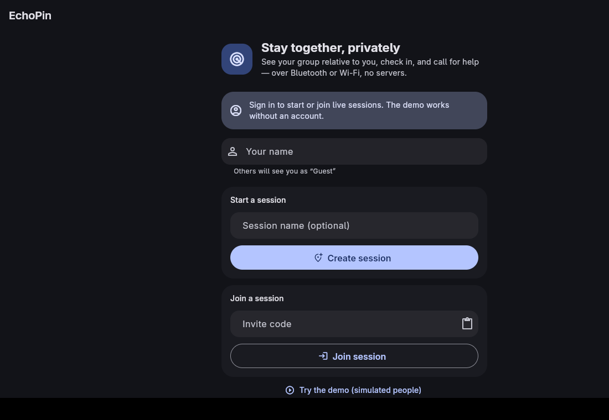
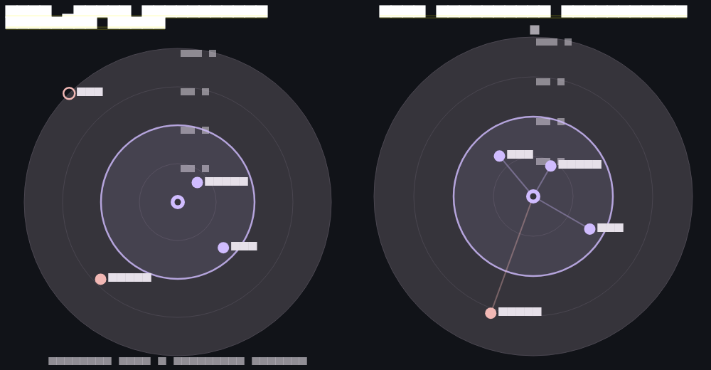
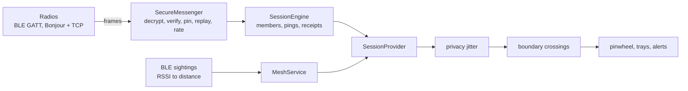
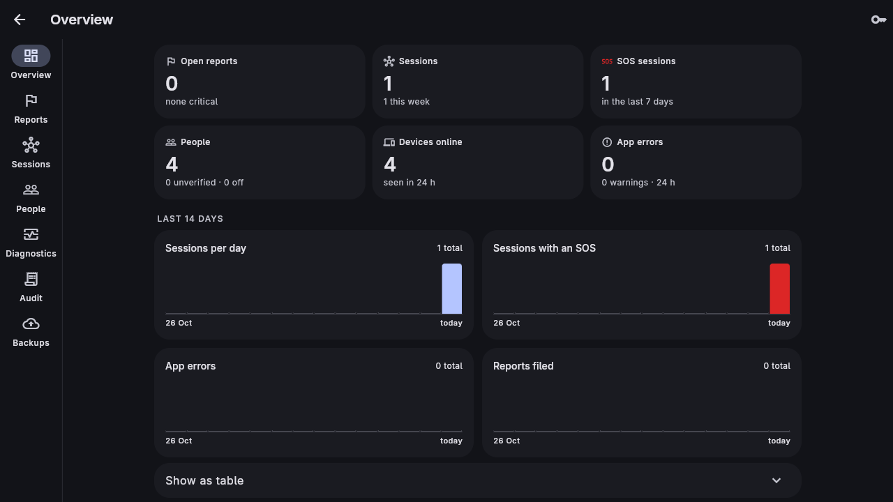

# EchoPin

**Keep your group together, privately.**
See where your people are relative to you, check in, and call for help,
phone to phone over Bluetooth or Wi-Fi. No GPS. No coordinates. No server
needed.

---

## Try it in a minute

| Where | How |
| --- | --- |
| **In the browser** | Open the [web demo](https://beekontek.github.io/EchoPin/) and tap **Try the demo**. Four simulated people run the real protocol: encryption, signatures, check-ins and SOS. |
| **On Android** | `flutter build apk --release`, then `scripts/share_apk.sh` prints a QR code; phones on your Wi-Fi scan it and install. |
| **On Linux** | `flutter run -d linux` |

Everything above works with **no server**. Organisations can add the optional
[EchoPin server](docs/SERVER.md) for verified accounts, sealed emergency
records, a responder console and encrypted backups; a free hosted setup
takes an afternoon ([guide](docs/DEPLOY_HOSTED.md)).

## What it does

A small group creates or joins a temporary **session** with an invite code
or QR. Each phone shows the others on a **pinwheel** around "you": distance
from Bluetooth signal strength (up to 100 m) inside a boundary circle you
drag to size. Cross the boundary and everyone is told. Anyone can **check
in** on selected people or everyone, and anyone can raise an **SOS** that
reaches every member, with delivery receipts and answers.

 Left: Bluetooth peers. Bluetooth measures distance, not direction, so people sit at their distance with no bearing and the radar says so. Right: the demo, whose people have simulated directions.

## Features

| Feature | What you get |
| --- | --- |
| **Invites** | `ECHO-XXXX-XXXX-XXXX-XXXX-CC` codes carry the session secret (about 78 bits) plus a typo-catching checksum. Share as QR, code or `echopin://join` link. Every mistake gets a precise message. |
| **Pinwheel** | 100 m radar, rings every 25 m, drag-to-set boundary (10 to 100 m), privacy jitter, SOS halos. Honest about direction: none is invented. |
| **Peer tray** | Animated cards slide in and out as people appear and leave: live distance, radio, verification badge, ping status. |
| **Pings and SOS** | *I'm OK*, *On my way*, *Need help*. SOS is press-and-hold, reaches late joiners, resolves everywhere on *I'm safe*. Retries until delivered. |
| **Verification** | A 12-digit per-session safety code per member. Compare in person, mark verified. |
| **Two radios** | Bluetooth LE for offline use and distance; Wi-Fi or a hotspot for range. Both at once, duplicates dropped. |
| **Alerts** | In-app banner, haptics, OS notifications on Android, iOS, macOS, Linux and Windows. An SOS always notifies. |
| **Admin panel** | PIN-protected diagnostics, radio and alert settings, synthetic test peers, audit log. Fully offline. |
| **Accounts** (optional) | Email-verified accounts, device-bound sign-in (no IMEI), two-step sign-in, an account PIN on each phone, *Report a problem*. |
| **Console** (optional) | Cross-device overview, report triage, sealed session records opened only by audited break-glass, people, diagnostics, audit chain, backups. |

## How it works

- **Membership is the code.** HKDF turns the invite code into the session id
  and key; nobody without the code, EchoPin included, can read session
  traffic.
- **Encrypted and signed.** XChaCha20-Poly1305 envelopes, Ed25519 signatures
  with a fresh key per device per session, pinned sender ids, a replay
  window, clock window, rate limits and a 20-member cap.
- **Native code moves opaque bytes.** All cryptography is Dart, identical on
  every platform and tested on the desktop.
- **Relative only.** No field anywhere holds a coordinate. Distances are
  jittered (plus or minus 7 m by default, fixed per peer per minute) before
  alerts or the UI see them.

Full detail: [Architecture](docs/ARCHITECTURE.md), [Protocol](docs/PROTOCOL.md), [Threat model](docs/THREAT_MODEL.md).

## With a server

Build with `--dart-define=ECHOPIN_SERVER_URL=https://your-server` and the
app gains accounts and a console; without it, it is exactly the app above.

- **Sign-in that doesn't trust hardware ids.** Each install has its own
  Ed25519 device key in the keystore; sign-in and every token refresh are
  signed by it. Argon2id passwords, 8-digit email codes, optional TOTP
  (required for staff), lockouts that can't be used to lock the owner out.
- **Account PIN.** Like the admin panel: a local PIN guards Account,
  reports and the console on each phone, never sessions or SOS.
- **Sealed emergency records.** Each live session is recorded on the phone
  (never coordinates), sealed twice (custodian key, then escrow key) and
  uploaded through an offline-tolerant outbox, with a checkpoint seconds
  after an SOS. The server alone cannot read them.
- **Break-glass, not browsing.** A responder opens a record by giving a
  reason; the grant and reason land in an append-only, HMAC-chained audit
  log and every admin is emailed.
- **Hardened by review and live testing.** See the
  [security review](docs/SECURITY_REVIEW.md): findings, fixes, and what
  still remains.

Server docs: [SERVER.md](docs/SERVER.md). Hosted for free: [DEPLOY_HOSTED.md](docs/DEPLOY_HOSTED.md).

## Platform support

| Platform | Bluetooth | Wi-Fi | QR scan | Notes |
| --- | --- | --- | --- | --- |
| Android | yes, tested on phones | yes | yes | Release APK built on Linux; install by QR code |
| iOS | yes, built in CI | yes | yes | Foreground BLE; needs a Mac to build and sign |
| macOS | no | yes | yes | macOS host |
| Linux | no | yes | paste | Needs avahi for Bonjour |
| Windows | no | yes | paste | Build not yet verified |
| Web | no | no | yes | Demo only: browsers cannot use these radios |

## Documentation

| Read this for | Document |
| --- | --- |
| The whole system in diagrams | [docs/ARCHITECTURE.md](docs/ARCHITECTURE.md) |
| What every file does, and where to look when something breaks | [docs/CODE_MAP.md](docs/CODE_MAP.md) |
| Coding, testing, system test cases with results, installation | [docs/IMPLEMENTATION.md](docs/IMPLEMENTATION.md) ([PDF](docs/IMPLEMENTATION.pdf)) |
| Getting a development machine ready | [docs/SETUP.md](docs/SETUP.md) |
| The wire protocol (normative) | [docs/PROTOCOL.md](docs/PROTOCOL.md) |
| Threats, mitigations, residual risk | [docs/THREAT_MODEL.md](docs/THREAT_MODEL.md) |
| The server: identity, records, audit, backups, config, API | [docs/SERVER.md](docs/SERVER.md) |
| Free hosting on Render + Supabase + Brevo | [docs/DEPLOY_HOSTED.md](docs/DEPLOY_HOSTED.md) |
| Security review of accounts and verification | [docs/SECURITY_REVIEW.md](docs/SECURITY_REVIEW.md) |
| A 30-minute live demo script | [docs/DEMO_SCRIPT.md](docs/DEMO_SCRIPT.md) |
| Slides, speech and code reference for the 0.4 update | [docs/presentation/](docs/presentation/) |
| What is open, and the rules that must hold | [docs/HANDOFF.md](docs/HANDOFF.md) |

## Development

    flutter pub get && (cd packages/echopin_protocol && dart pub get) && (cd server && dart pub get)
    flutter analyze                                # must be clean, covers all three packages
    flutter test                                   # app: 241 unit + widget tests
    (cd server && tool/test.sh)                    # server: 75 tests on a throwaway PostgreSQL
    (cd server && tool/live_check.sh)              # system test: 31 end-to-end checks over HTTP
    (cd packages/echopin_protocol && dart test)    # shared crypto and models
    xvfb-run -a flutter test integration_test/lan_transport_test.dart -d linux   # real Bonjour + TCP

Every text field is capped in the app at the exact limit the server
enforces (one shared `ProtocolLimits`), and every failure is a typed error
with a human sentence. Details and the validation matrix are in
[docs/IMPLEMENTATION.md](docs/IMPLEMENTATION.md).

### Building

    flutter build apk --release              # Android (debug key unless android/key.properties exists)
    flutter build linux --release            # needs clang cmake ninja-build libgtk-3-dev libsecret-1-dev
    flutter build web --release
    flutter build ios --no-codesign          # macOS host
    flutter build macos                      # macOS host
    flutter build windows                    # Windows host

Add `--dart-define=ECHOPIN_SERVER_URL=...` and
`--dart-define=ECHOPIN_CUSTODIAN_KEY=...` to point a build at your server.
An iPhone build needs a Mac and an Apple certificate; the options are in
[docs/SETUP.md](docs/SETUP.md).

## Status

Verified: analyzer and formatter clean; all app, server, protocol and
system tests pass; the Linux integration test passes; Android, Linux and
web release builds; a live hosted deployment with email and backups
working end to end; and Bluetooth LE between Android phones in the field:
discovery, joining, check-ins, SOS and boundary alerts all behaved as
designed. The radar's distance is an estimate from signal strength and
moves with bodies, walls and how a phone is held, so it is close rather
than exact; the app shows it as "about" and jitters it on purpose.

Not yet verified (needs hardware or another OS): iOS and macOS on a
device, the Windows build, and background operation. Each is tracked in
[docs/HANDOFF.md](docs/HANDOFF.md).

## Contributing and license

Issues and pull requests are welcome: see [CONTRIBUTING.md](CONTRIBUTING.md)
and the [code of conduct](CODE_OF_CONDUCT.md). EchoPin is released under
the [MIT License](LICENSE).
