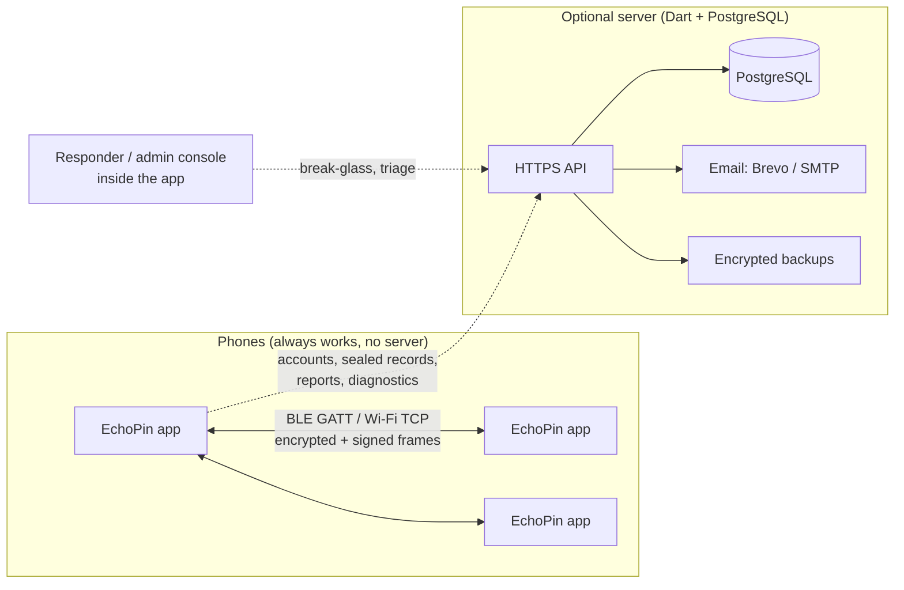
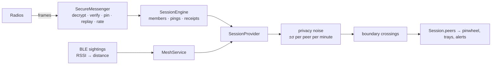
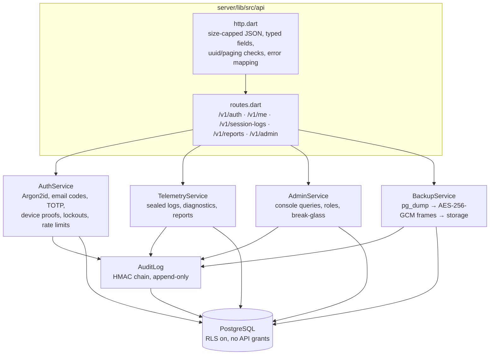
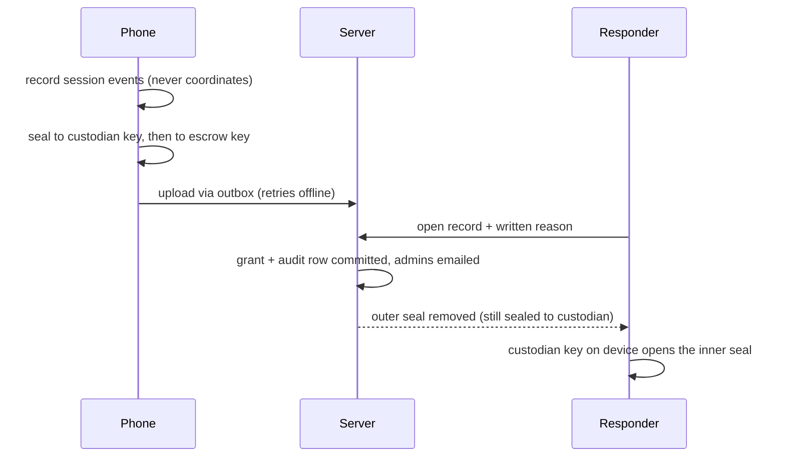

# Architecture

EchoPin is two things that work independently: a **phone-to-phone app**
that needs no infrastructure, and an **optional server** that adds
accounts, sealed emergency records and a staff console. This document is
the map; `docs/CODE_MAP.md` names every file, `docs/PROTOCOL.md` is the
normative wire format, and `docs/SERVER.md` covers the server in depth.

## The two halves



Sessions never go through the server. The server only ever receives
**sealed** session records it cannot read itself, plus reports and
diagnostics.

## The app

### Layers

```mermaid
flowchart TB
  UI[screens/ + widgets/<br/>home, session, pinwheel, trays, account, console]
  P[providers/<br/>Session · Alert · Settings · Admin · Account · AccountLock · Outbox]
  E[session/ SessionEngine<br/>membership, pings, SOS, receipts, retries]
  SEC[security/<br/>invite code → keys (HKDF), Ed25519 identity,<br/>XChaCha20-Poly1305 envelopes, replay + rate limits]
  T[transport/ + services/<br/>BLE bridge, Bonjour + TCP, loopback, MeshService, noise]
  N[Native plugins<br/>Kotlin + Swift: advertise, scan, GATT bytes]
  UI --> P --> E --> SEC --> T --> N
```

- **Native code moves opaque bytes.** All cryptography is in Dart, so it is
  identical on every platform and tested on the desktop.
- **Providers are plain `ChangeNotifier`s** exposed through
  `InheritedNotifier` scopes; there is no state-management dependency.
- **Every failure is an `EchoError`** with a human sentence; status trays
  show it with a one-tap fix where one exists.

### The session pipeline



Distance is estimated from Bluetooth signal strength on the receiving
phone. No direction is measured, so the pinwheel places Bluetooth peers at
their distance without a bearing and says so; only the demo and admin test
people carry simulated directions.

### Local security

| Concern | Mechanism |
| --- | --- |
| Membership | possession of the invite code (`ECHO-XXXX-…-CC`, ~78 bits + checksum); HKDF derives the session id and key |
| Confidentiality and integrity | XChaCha20-Poly1305 envelopes, Ed25519 signatures with a fresh key per device per session, sender ids pinned on first use |
| Replay and flooding | 64-message window, ±2 min clock window, per-sender rate limits, 20-member cap |
| Untrusted text | names and notes stripped of control/bidi characters and length-capped |
| Secrets at rest | invite history, admin and account PIN hashes, device key in the OS keystore (fallback: app preferences, with a visible warning) |
| Local locks | admin panel and signed-in account each behind a PBKDF2 PIN with lockout and idle auto-lock |

## The server



### Identity without hardware ids

Each install generates an Ed25519 **device key** in the keystore. Sign-in,
token refresh and uploads carry a signed, time-bound proof, so a stolen
refresh token is useless without the device, a replayed one signs the
device out, and no IMEI, serial or advertising id is ever read.

### Sealed records and break-glass



The server alone cannot read a record: the custodian key never leaves
responders' devices. Every opening is in the audit chain, which is keyed
from a secret outside the database and refuses updates and deletes at the
database level.

### Trust boundaries and validation

Every request passes the same gate (`api/http.dart`): bodies are size-
capped and must be JSON objects; fields are read through typed accessors
with the limits in `packages/echopin_protocol` (`ProtocolLimits`), which
the app uses for its `maxLength`s too; ids in URLs are validated before any
query; paging is clamped; and any exception becomes a safe JSON error
(PostgreSQL value errors → 400, uniqueness clashes → 409, anything else →
500 with a generic message and a server-side log). Roles are re-read from
the database on every request, so revocation is immediate.

## Data at rest

| Where | What | Protection |
| --- | --- | --- |
| Phone keystore | invite history, PIN hashes, device key, cached escrow key | OS keystore; plain preferences only where none exists (warned) |
| Phone outbox | sealed uploads waiting for signal | already sealed |
| PostgreSQL | accounts (Argon2id hashes), devices, token hashes, sealed records, reports, audit chain | RLS on, Supabase API grants revoked, TLS |
| Backups | `pg_dump` of the public schema | AES-256-GCM in 1 MiB frames, keyed from `ECHOPIN_KEYS`, private bucket |

## Repository layout

    lib/                 the app (see docs/CODE_MAP.md)
    android/ ios/        native BLE plugins (Kotlin, Swift)
    linux/ macos/ windows/ web/   platform runners
    packages/echopin_protocol/    sealed boxes, device proofs, shared enums and limits
    server/              the central server, CLI and system test
    scripts/             share_apk.sh (install by QR code)
    docs/                this folder; presentation/ holds the slide deck
    .github/workflows/   CI: lint, test, build, pages, keep-alive
