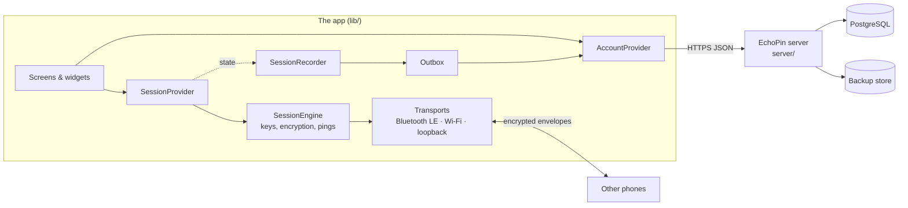
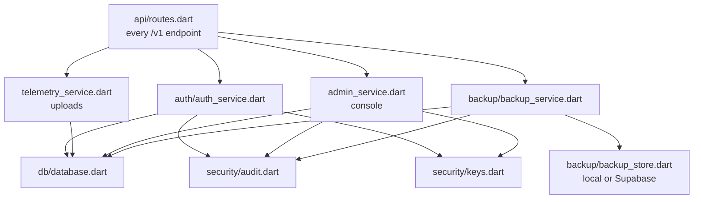

# EchoPin code map

A guided tour: what each part of the code does, how the parts connect, and
where to look first for a given question. Each file also opens with a
comment explaining its job. Look for `SECURITY:` comments where code does
something for a reason that is easy to undo by accident.

## The big picture

- **Sessions run phone to phone.** The server is optional and never
  carries session traffic.
- **With a server configured** (`--dart-define=ECHOPIN_SERVER_URL=…`),
  phones also sign in, upload sealed session records, diagnostics and
  reports, and staff use the console.
- `packages/echopin_protocol` holds the code both sides must agree on
  byte for byte.

## The app (`lib/`)

### Start-up and plumbing
| File | What it does |
| --- | --- |
| `main.dart` | Entry point. Probes the platform, creates every long-lived object once, and hands them down through `*Scope` widgets |
| `services/bootstrap.dart` | Decides at start-up what works on this device: secure storage, notifications, Bluetooth |
| `providers/*_scope.dart` | `InheritedNotifier` wrappers: `XScope.of(context)` to watch, `.read(context)` to use once |
| `core/echo_error.dart` | Every error a person can see, as a closed set of types with human sentences |
| `app_info.dart` | App version (keep in step with `pubspec.yaml`) |

### Sessions (phone to phone)
| File | What it does |
| --- | --- |
| `providers/session_provider.dart` | **Start here.** The UI's single source of session state. Merges radio sightings with authenticated members, adds privacy noise, detects boundary crossings, runs status trays and history |
| `session/session_engine.dart` | The protocol: hello / ping / receipt / reply / bye, retries, delivery receipts, membership, SOS until "I'm safe" |
| `session/demo_crowd.dart` | Simulated people for demo mode. They run the real protocol over the loopback transport |
| `services/session_codec.dart` | Invite codes `ECHO-XXXX-…-CC`: parse, checksum, format |
| `services/session_history_service.dart` | Recent sessions for quick rejoin |

### Security (phone to phone)
| File | What it does |
| --- | --- |
| `security/session_credentials.dart` | Derives the session id, key and server membership tag from the invite code (HKDF) |
| `security/session_identity.dart` | Per-session Ed25519 identity; a peer id is a short hash of the public key |
| `security/secure_messenger.dart` | Seals and opens every message: XChaCha20-Poly1305 plus a signature, key pinning, clock window |
| `security/replay_guard.dart` | Refuses repeated or very old message counters per sender |
| `security/rate_limiter.dart` | Token bucket per sender, so nobody can flood a session |
| `security/wire.dart` | Message kinds inside the encrypted envelope |

The normative description is `docs/PROTOCOL.md`; the threat analysis is
`docs/THREAT_MODEL.md`.

### Radios
| File | What it does |
| --- | --- |
| `transport/message_transport.dart` | The interface every radio implements; carries only encrypted bytes |
| `services/ble_mesh_transport.dart` | Bluetooth LE: messages through a GATT inbox, plus signal-strength presence |
| `services/platform_ble_bridge.dart`, `method_channel_ble_bridge.dart` | Dart side of the native Bluetooth plugins (`android/…/BleBridgePlugin.kt`, `ios/Runner/BleBridgePlugin.swift`) |
| `transport/lan_transport*.dart` | Wi-Fi / hotspot: Bonjour discovery plus framed TCP (stub on web) |
| `transport/loopback_transport.dart` | In-memory radio for tests and demo mode |
| `services/mesh_service.dart` | The stream of who is nearby (real or simulated) |
| `services/connectivity_service.dart`, `network_interfaces*.dart` | Is Bluetooth on, is Wi-Fi connected; feeds the status trays |
| `services/ble_permission_service.dart` | Asks for Bluetooth permissions |

### Distances, alerts, notifications
| File | What it does |
| --- | --- |
| `services/location_engine.dart` | Bearing maths and display jitter on distances (no GPS, ever) |
| `services/boundary_monitor.dart` | Pure function: who crossed the boundary radius between two snapshots |
| `providers/alert_provider.dart` | Throttles crossing alerts, fires haptics and notifications |
| `services/notification_service.dart` + `*_notification_backend.dart` | OS notifications where available, silent elsewhere |
| `services/haptic_service.dart` | Vibration with a user switch |

### Storage
| File | What it does |
| --- | --- |
| `services/key_value_store.dart` | The storage interface everything uses |
| `services/secure_kv_store.dart` | OS keystore (Keychain, Keystore, libsecret…) |
| `services/prefs_kv_store.dart` | Plain preferences, the fallback where no keystore exists |
| `services/secure_store.dart` | The per-install secret, migrated into secure storage |
| `services/settings_service.dart`, `models/app_settings.dart` | User and admin settings |

### Accounts and the server connection (`lib/account/`)
| File | What it does |
| --- | --- |
| `api_client.dart` | JSON over HTTPS; turns failures into `OfflineError` / `AccountError`; learns the server clock |
| `account_provider.dart` | Sign-up, confirm, sign-in, token refresh (one at a time), escrow and custodian key cache (with pinning), custodian private keys for responders, two-step, devices. Offline-first: you stay signed in without signal |
| `device_key.dart` | This install's Ed25519 device key, which replaces any IMEI-style id |
| `account_models.dart` | `Account`, `AuthTokens`, `EscrowKey` |
| `outbox.dart` | Store-and-forward queue for uploads; seals records (twice with a custodian key); idempotent, account-bound, backs off |
| `session_recorder.dart` | Watches the session and uploads a sealed record: quickly after SOS or "need help", periodically, and at the end. Recovers a draft after a crash |

### Screens and widgets
| File | What it does |
| --- | --- |
| `screens/home_screen.dart` | Name, create / join / rejoin, demo, sign-in prompt |
| `screens/session_screen.dart` | The live session: pinwheel, people sheet, check-in, SOS, invite, safety codes |
| `screens/qr_scan_screen.dart` | Scan an invite QR |
| `screens/report_screen.dart` | File a report (optionally with diagnostics) |
| `screens/account/` | Sign-in / sign-up / confirm / reset, and the account page (devices, two-step, my reports, uploads, account PIN) |
| `screens/account/account_lock_gate.dart` | The account PIN screen and `AccountLockGuard`, which wraps Account, reports and the console: hidden behind the PIN while locked, kept alive so an auto-lock loses nothing. Rules are in `providers/account_lock_provider.dart` (PIN per sign-in, 5-minute idle lock, sign-out after 3 lockouts); the PIN itself uses `AdminAuthService.account` |
| `screens/console/` | The central console, tabs by role: overview, reports, sessions (with break-glass), and for admins people, diagnostics, audit, backups |
| `screens/admin/` | The *on-device* admin panel behind a PIN (`services/admin_auth_service.dart`, `providers/admin_provider.dart`). Unrelated to server roles. Its PIN code is shared with the account lock, with separate storage |
| `widgets/` | Reusable pieces: trays, pinwheel painter, SOS button, ping trays, status trays, alert banner, `ui_bits.dart` (small shared bits) |
| `ui/theme.dart`, `ui/format.dart` | Visual system and display formatting |
| `models/` | Plain data: session, peers, pings, alerts, trays, summaries |

## Shared protocol (`packages/echopin_protocol/`)
| File | What it does |
| --- | --- |
| `sealed_box.dart` | Seals a session record to the server's escrow key (X25519 + HKDF + XChaCha20-Poly1305). The phone can seal; only the escrow key opens |
| `device_proof.dart` | The signed statement a phone sends at sign-in and refresh |
| `models.dart` | Roles, report categories, severities and statuses, limits: the shared vocabulary |

## The server (`server/`)

| File | What it does |
| --- | --- |
| `bin/server.dart` | Starts the server: config → database → keys → migrations → backups → HTTP |
| `bin/echopin_admin.dart` | Operator CLI: `init-keys`, `init-custodian`, `create-admin`, `backup`, `verify-backup`, `restore`, `audit-verify`, `rotate-escrow` |
| `lib/echopin_server.dart` | Composition root: builds every service and the middleware pipeline |
| `src/config.dart` | Every environment variable, validated once, with one-sentence errors |
| `src/api/http.dart` | Errors-as-JSON, body limits, typed field access, security headers, CORS, client IP (read the `SECURITY:` note) |
| `src/api/routes.dart` | The endpoint table. Thin: parse input, call a service |
| `src/auth/auth_service.dart` | Accounts, email codes, sign-in, tokens, lockout, two-step, devices. Most `SECURITY:` notes live here |
| `src/auth/passwords.dart` | Argon2id hashing on a separate isolate, password rules |
| `src/auth/totp.dart` | RFC 6238 authenticator codes |
| `src/security/tokens.dart` | Random tokens and codes; only hashes are stored |
| `src/security/keys.dart` | Escrow, data, backup and audit keys, from `ECHOPIN_KEYS` or a keys folder |
| `src/security/audit.dart` | Append-only, HMAC-chained audit log and its verifier |
| `src/security/rate_limit.dart` | Rate limits: PostgreSQL-backed (production) and in-memory (tests) |
| `src/security/custodian.dart` | Custodian keys for the optional second seal |
| `src/auth/breach_check.dart` | Breached-password check (HIBP range API, k-anonymity) |
| `src/retention_service.dart` | Daily deletion of data past its retention period |
| `src/telemetry_service.dart` | Stores diagnostics, sealed logs (idempotent) and reports; never reads sealed content |
| `src/admin_service.dart` | Console queries and actions; checks roles itself; break-glass `unseal` |
| `src/backup/*` | Encrypted backups, verification, restore, storage backends |
| `src/db/database.dart` | Connection pool, TLS defaults, transactions |
| `src/db/migrations.dart` | The schema, applied in order under a lock (including the audit immutability triggers) |
| `src/mail/mailer.dart` | Console, SMTP, Brevo and Resend senders |

## Where to look for…

| Question | Look at |
| --- | --- |
| "Why can't I sign in?" | `auth_service.dart` `login`, then the app's `AccountProvider.signIn` |
| "Why is my account asking for a PIN?" | `providers/account_lock_provider.dart` (when it locks, why it signs out) |
| "How is a session encrypted?" | `docs/PROTOCOL.md`, `security/secure_messenger.dart` |
| "Who opened this record?" | Console → Sessions → a session → Access history; `admin_service.dart` `unseal` |
| "What's in a session record?" | `account/session_recorder.dart` (the app builds it, then seals it) |
| "Is the audit log intact?" | Console → Audit → Check chain; `security/audit.dart` |
| "What was reviewed for security?" | `docs/SECURITY_REVIEW.md` |
| "How do I deploy?" | `docs/DEPLOY_HOSTED.md` (free hosting), `docs/SERVER.md` (everything else) |
